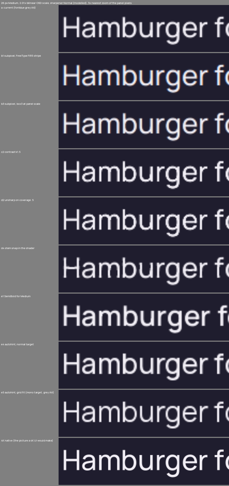
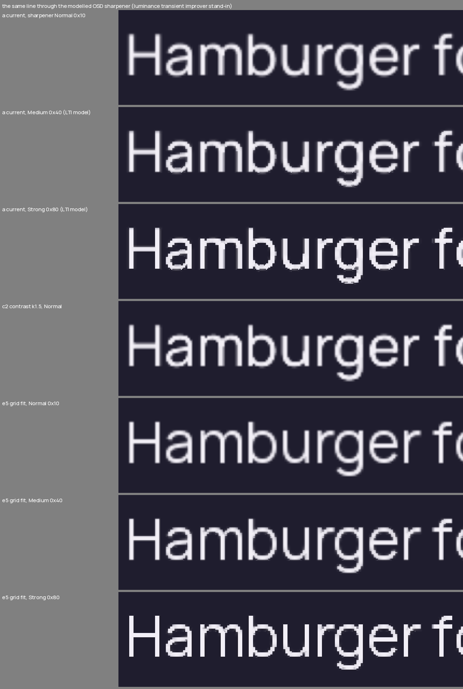

# Text rendering: crisper letters after the OSD's x2

Research of 2026-10-29, no TV access. The question: the UI is 1920x1080 and the display chip's OSD scaler takes it to the panel by 2.01 with a
filter nobody has measured; can LumaTV's own text rendering make letters crisp up close, without the jagged look of the OSD sharpener's Strong
setting? Evidence is a host simulation of the TV path (below) over the shell's own rasteriser and faces; nothing here has run on the panel.
Prior: `ui-sharpness-result.md` (the cause, the closed options), `display-lab-result.md` (the lab).

## Resume here

Done (host, committed to forge/main): the study (`tools/textsim.py`, `rustui/ui/examples/textcov.rs`, `docs/research/text-render/`), the winner built
as the theme's `text.gridFit` (off by default): grid-fitted glyphs, `rustui/ui/src/kit/gridfit.rs`, through a glyph source hook on `ui::text::Fonts`
that rustui now carries as a patch of its own copy of LumaShow's `ui` crate (`rustui/lumashow-ui/`, `rustui/patches/ui/`, § 5); and a Display lab
step, "Text", A the shell's letters, B the same letters grid-fitted, drawn by the lab itself (nothing written to the helper).

Next, in order:

1. Main installs (Face ID). Nothing is on by default: the shipped theme has `"text": {"gridFit": false}`.
2. The TV check (§ 6), Round19 at the set with Nitin: the lab's last step (Settings > Picture > Expert > Display lab), at 50 cm.
3. If B is better: Nitin's theme gets `{"text": {"gridFit": true}}` (`<data dir>/theme/theme.json`; read when the Rust shell starts), and the
   shipped default is Nitin's call. The hook is LumaTV's patch of a copy; moving it into LumaShow's own `Fonts` is Nitin's call too.

## Verdict

- **Grid-fitted glyphs are the clear winner**: stems and bars on whole page pixels, curves still antialiased. On the model, a stem's edge rises
  in **1.84 panel pixels (worst case 2.09)** against **2.67 (worst 3.56)** now, with no overshoot and no extra stair steps (slopes and curves stay
  antialiased). An edge between whole page pixels is one page pixel wide on the panel; an edge inside a pixel, which is where most edges of
  a 2.3 px stem fall, is two.
- Text-only tricks in the glyph shader (a steeper antialiasing ramp, an unsharp mask on the coverage, stem darkening) are real but small and
  they cost what the OSD sharpener costs: rise 2.67 to 2.27 at a contrast of 1.5, and the stair steps of a slanted edge 0.18 to 0.28 panel pixels
  (the modelled Medium sharpener is 0.35). They cannot move an edge that sits at half a pixel without moving it: the worst case stays at 3.2.
  Not built.
- **Subpixel (ClearType-style) antialiasing does not help, as expected**: the edge rise does not narrow (2.69 to 2.90 against 2.67), the error
  against a native 4K picture grows (0.107 against 0.085) and every letter gets colour fringes, 33 to 66 percent of the contrast at the worst
  pixel, 11 to 21 percent on average.
- A heavier face (SemiBold for Medium) changes weight, not edges (2.55 against 2.67). FreeType's autohinter at its normal or light target moves
  edges but leaves the stem width smooth: 2.34 and 2.66.
- Costs of grid fit, to be judged on the TV: stems become whole numbers of pixels, so weight steps with size: the ink of a line moves by -8 to
  +10 percent at 21 to 28 px, and a 19 px Regular line, whose 1.4 px stems become 1, loses 22 percent and looks thin. Glyph shapes move up to half a
  page pixel (one on the panel) from their outline. Layout is untouched: the advance is the built-in rasteriser's.

## 1. The simulation

`tools/textsim.py` draws a line of text the way each candidate would and runs it through a model of the TV path. Coverage comes from the UI's own
rasteriser (`fontdue`, the three Manrope faces, `rustui/ui/examples/textcov.rs`) at the page's pixels with glyphs on whole pixels as
`ui::text::Fonts::draw` places them; the native reference is the same line drawn at 2.01 times the size and averaged (what a 4K UI would put on the
panel, the glyph origins where the page has them). Hinted coverage is FreeType 2.13's autohinter (freetype-py); the Rust build uses `skrifa`'s port
of it (§ 5). Colours are the shipped theme's: ink `#F2EFF6` on sheet `#1F1D2E`, dark; `#17131F` on `#FAF4ED`, light. Compositing is source over in
encoded values (the GL blend, no gamma), as the page is.

| Stage | Model | Grounds |
|---|---|---|
| Page | 1920x1080, text at the theme's sizes 19 to 40 px | `REPO`, `payload/theme/theme.json` |
| OSD scaler | 2.01 both ways (3860/1920 and 2170/1080 are 2.0104 and 2.0093); output pixel `j` samples the page at `(j + 0.5 - phase)/2.01 - 0.5`; **bilinear**, with a Catmull-Rom cubic as the bracket; four phases (a line at another place on the screen meets the scaler at another phase) | `TV` (`hdr1`, `hdr2`); the kernel is `[INFERENCE]`, filter select 0 |
| OSD sharpener | `osd_sr` gain 0x10 on the set (Normal); `0x40` Medium, `0x80` Strong. The kernel is closed firmware (`reg_lti_2d_gain` only), so two stand-ins: `lti` moves a pixel toward the local extreme on its side, weight `gain/0x80` (no overshoot, stair steps on slopes) and `peak`, a linear unsharp mask (overshoot) | `[INFERENCE]`: what the sharpener really does is the lab's question |
| Panel | the crop of 3840x2160; crops below are panel pixels at 3x nearest | |

Measures, all in panel pixels on luma normalised so the ground is 0 and the ink 1: **stem rise**, the 10 to 90 percent rise of every flank of the
stems of `IlIlIl` (sizes 22 to 28, four phases) and **bar rise**, the same down the arms of `ETETET`; **worst**, the largest flank; **RMSE** and
**sharp** (gradient energy, 1 is a native 4K picture) against the native reference of the same face over six lines of 19 to 40 px; **over**, the
overshoot beyond the ink and the ground in percent of the contrast; **ink**, against the reference's; **stairs**, the RMS of the edge's place about
its best line on ideal slanted edges at 4, 8, 15 and 30 degrees; **colour**, the largest spread between a pixel's channels on neutral text.
The reference's own stairs measure 0.06.

## 2. Results

Bilinear scaler, sharpener Normal 0x10 modelled (`docs/research/text-render/study.json` has every row and the robustness runs).

| Candidate | Stem rise (worst) | Bar rise (worst) | RMSE | Sharp | Ink | Stairs | Colour max / mean |
|---|---|---|---|---|---|---|---|
| **a** current | 2.67 (3.56) | 2.77 (3.45) | 0.085 | 0.54 | 1.00 | 0.18 | 0 |
| **b1** subpixel, FreeType's FIR5 stripe | 2.90 (3.47) | 2.78 (3.46) | 0.108 | 0.50 | 1.00 | | 63 / 21 % |
| **b3** subpixel, offsets at the panel's scale | 2.69 (3.58) | 2.78 (3.46) | 0.107 | 0.52 | 1.00 | | 33 / 11 % |
| **c1** contrast 1.25 (steeper ramp about the half point) | 2.46 (3.20) | 2.51 (3.38) | 0.083 | 0.59 | 1.00 | 0.24 | 0 |
| **c2** contrast 1.5 | 2.27 (3.18) | 2.29 (3.32) | 0.084 | 0.62 | 1.00 | 0.28 | 0 |
| **c4** contrast 3 | 1.93 (2.72) | 2.01 (3.21) | 0.092 | 0.68 | 0.99 | 0.40 | 0 |
| **c5** stem darkening, coverage^0.8 | 2.67 (3.39) | 2.79 (3.35) | 0.087 | 0.54 | 1.06 | 0.18 | 0 |
| **d2** unsharp on the coverage, 0.5 (what a texel-tap shader can do) | 2.27 (3.18) | 2.29 (3.32) | 0.085 | 0.64 | 1.01 | 0.29 | 0 |
| **d4** stem snap in the shader (runs of up to 3.6 px redrawn on whole pixels) | 1.86 (2.22) | 1.84 (2.08) | 0.092 | 0.57 | 1.00 | 0.18 | 0 |
| **e1** SemiBold for Medium | 2.55 (3.22) | 2.74 (3.28) | 0.083 | 0.55 | 1.00 | | 0 |
| **e3** autohint, light (vertical only) | 2.66 (3.51) | 2.26 (3.21) | 0.119 | 0.55 | 1.01 | | 0 |
| **e4** autohint, normal target | 2.34 (3.22) | 2.26 (3.21) | 0.142 | 0.58 | 1.05 | | 0 |
| **e5 grid fit** (autohint at the mono target, drawn antialiased) | **1.84 (2.09)** | **1.84 (2.08)** | 0.156 | 0.62 | 0.97 | 0.18 | 0 |

Grid fit and the shader snap leave slanted edges to the antialiasing, so their stairs are the current path's (the ideal slanted edges are not
thin runs and are not changed by either).

How to read it. The 1.64 to 3.41 spread of an ideal edge on the current path is the whole story (`step`, below): an edge on a pixel boundary rises
in 1.6 panel pixels, an edge at half a pixel in 3.4. A curve that keeps the edge where it is cannot touch the half-pixel case; one that moves it
(contrast 3) shifts edges up to 0.73 panel pixels and breaks slanted edges into steps. Only moving every stem edge onto a boundary, consistently,
narrows the worst case, and only grid fitting does that without the stairs, because it leaves slopes alone.

RMSE and sharp are against the true outlines, so grid fit scores worse on RMSE (0.156): hinting moves features, by up to half a page pixel, by
design. The crops are the better judge of that.

The ideal edge, over the edge's place in a pixel (8 places) and the scaler's four phases:

| Pipeline | 10 to 90 rise: mean (best, worst) | Overshoot | Edge position error (worst) |
|---|---|---|---|
| bilinear, current | 2.84 (1.64, 3.41) | 0 | 0.17 |
| bilinear, current, Normal 0x10 | 2.71 (1.62, 3.24) | 0 | 0.27 |
| bilinear, contrast 1.5 | 2.42 (1.62, 3.24) | 0 | 0.48 |
| bilinear, contrast 3 | 2.11 (1.62, 3.24) | 0 | 0.73 |
| **bilinear, edge on a boundary (grid fit)** | **1.83 (1.62, 2.08)** | 0 | 0.10 |
| cubic scaler, current | 2.49 (1.60, 3.10) | 4.9 % (7.4 worst) | 0.19 |
| cubic scaler, grid fit | 1.54 (1.50, 1.58) | 7.1 % (7.4) | 0.11 |

### The sharpener, as modelled

| Text | Sharpener | Stem rise (worst) | Over | Stairs |
|---|---|---|---|---|
| current | Normal 0x10 | 2.67 (3.56) | 0 | 0.18 |
| current | Medium 0x40, `lti` | 2.19 (3.27) | 0 | 0.35 |
| current | Strong 0x80, `lti` | 1.38 (3.45) | 0 | 0.47 |
| current | Strong 0x80, `peak` | 2.08 (2.88) | 14.6 % | 0.18 |
| contrast 1.5 | Medium `lti` | 1.81 (2.72) | 0 | 0.42 |
| **grid fit** | Normal 0x10 | 1.84 (2.09) | 0 | 0.18 |
| **grid fit** | Medium 0x40 `lti` | 1.41 (1.47) | 0 | |
| **grid fit** | Strong 0x80 `lti` | 0.80 (0.80) | 0 | |
| current / grid fit | cubic scaler, Normal | 2.19 (2.88) / 1.53 (1.59) | 12 / 14 % | |

The `lti` stand-in reproduces what Nitin saw of Strong: crisper, and stepped (0.47 against 0.18). It also shows why: the sharpener works on the
scaler's output, where it can only steepen a ramp that is already two to three pixels wide, so it raises the stairs of every slope with the same
gain that makes the stems crisp. Grid fitting lifts the stems first and leaves the sharpener the slopes. The sharpener at Normal (0x10) changes the
stem rise by 0.1 on the model, which agrees with "no visible effect"; the TV is the arbiter of the stand-in.

### Subpixel antialiasing (b), confirmed not to help

Three rows of the table: the stripe on the page's pixels (b1, b2) and with the offsets halved to the panel's scale (b3). The scaler samples the
page once for all three channels of a panel pixel, so a subpixel shift in the page is a shift of the channel's whole edge: each channel's ramp
keeps its width (2.7 to 2.9 against 2.67; the filter widens it) and the three ramps are staggered, which is a colour fringe and no narrower a
luma edge. The shifts of a page stripe, a third of a page pixel, are two thirds of a panel pixel and so twice the panel's own subpixel pitch
(four subpixels a pixel, WRGB, order `[INFERENCE]`); halved (b3) they still add a fringe of 11 percent a pixel and gain nothing. The WRGB panel's
white subpixel is derived from RGB by the set, so nothing a UI writes in a channel is the panel's to place. Crops: `crops-subpixel.png`.

### Hinting and weight (e)

FreeType's autohinter at the three targets (`e3`, `e4`, `e5`): light moves bars only, normal aligns edges and keeps the stem width smooth (a 2.31 px
stem becomes 2.45 with one edge on the grid), and the mono target rounds the stem width too (2.31 to 2), which is what puts both edges on boundaries
and gives 1.84 with a 2.09 worst case. The outline is then drawn with the same exact-area antialiasing as now, so curves keep grey edges. A bolder
face is a design change (`e1`, 0.12 px of rise) and not an edge one.

## 3. Crops

Panel pixels at 3x, 26 px Medium, bilinear, sharpener Normal modelled; the last row is the native 4K picture.
`docs/research/text-render/`: `crops-dark.png`, `crops-light.png` (every candidate), `crops-sharpener.png` (current and grid fit through Normal,
Medium and Strong), `crops-subpixel.png` (28 px, 8x), `crops-kernel.png` (a cubic scaler), `crops-sizes-light.png` (19 px Regular and 40 px
SemiBold). The Display lab's own render of the step: `docs/mocks/host-rust/displaylab/text-grid-fit-b.jpg`.

## 4. Decision

- Build grid fit and offer it as `text.gridFit`, off by default; judge it in the lab first. Not built: contrast, unsharp, stem darkening or the
  shader snap (d4: the same rise as grid fit on stems, but it breaks joins of stems and bowls, reads blotchy in the crops, needs a dozen or more texture taps a pixel
  in the glyph shader and cannot know a stem from a thin shape); subpixel antialiasing; a heavier face.
- Grid fit is a rasteriser change and the glyph raster is LumaShow's (`ui::text::Fonts`, `fontdue`), which LumaTV does not edit. rustui vendors the
  `ui` crate the way it vendors the renderer and carries a patch, `Fonts::set_glyph_source`: a default-off hook, behaviour unchanged without a
  source. The hook could later be upstreamed to LumaShow (Nitin's call).
- Combined with the OSD sharpener: not recommended as a pair on the model for Strong (0.80 rise is hard-edged on every stem); Normal or Medium over
  grid-fitted text is the combination to look at, `[INFERENCE]` until the TV.
- Weight at small sizes: a 19 px Regular stem falls to one page pixel. If the TV shows that thin, the remedy is a heavier face for the smallest
  size, a theme change, not a change to the rasteriser.

## 5. What was built

- `rustui/lumashow-ui/`: LumaShow's `ui` crate, copied by `rustui/tools/sync-lumashow.sh` and patched by `rustui/patches/ui/*.patch`
  (`lumatv-Cargo.patch`: its path to `compositor-protocol`, no unit tests run; `lumatv-build.patch` and `lumatv-src-text.patch`: the paths its build
  and fonts are read from, and the hook). `make-patches.sh` rewrites and checks them. `rustui/ui`, `rustui/tokens`, `rustui/app` and the compositor's
  `ui` feature point at it. Without a source set the crate behaves as LumaShow's does.
- `ui::text::GlyphSource` and `Fonts::set_glyph_source(Option<Box<dyn GlyphSource>>)`: `raster(face, px, glyph_index) -> Option<Raster>`; the advance
  stays the built-in's, a `None` (a space) is left to the built-in, setting a source forgets what was rastered. Tabular figures go through it too.
- `rustui/ui/src/kit/gridfit.rs`: `GridFit`, a `GlyphSource` on `skrifa` 0.44 (`Engine::Auto`, `Target::Mono`, a Rust port of FreeType's autohinter)
  and a font-rs style exact-area scan converter. Tests: stems and bars of whole pixels (20 to 32 px), curves keep grey edges, ink within -25 and
  +15 percent of the built-in's and the advance and measure unchanged, a space is left alone, a source taken away restores the built-in pixels, the
  converter is exact on a square, and the theme switch reaches every glyph of a `Kit` and leaves layout as it was.
- `lumatv-tokens`: `Tokens::grid_fit()` from `text.gridFit`; `payload/theme/theme.json`: `"text": {"gridFit": false}`; `Kit::new` installs the source
  when it is on. It is read when the Rust shell starts: a changed theme leaves the atlases already made as they are.
- The lab: step 7 of 7, group "Text", control `text` (the lab's own: `lab/plan.rs` `LOCAL`; the model sets it with no request, B is on the screen at
  once and counts as seen), on a new card, `Card::Type`: the shell's roles (40 SemiBold, 28, 26, 24 Medium, 21 and 19 Regular), black on white and
  white on black. A is the built-in rasteriser, B the grid-fitted one, each drawn by the lab with its own `Fonts` whatever the theme says; switching
  paints the card again.
  Tests: `lab/plan.rs`, `model.rs` (no word to the helper), `card.rs` (both looks, whole-pixel stems, the same words), `surface.rs` (the card is drawn
  again on the switch and on no other step), `tests/test_rust_displaylab.py`, renders in `docs/mocks/host-rust/displaylab/`.
- Tools: `tools/textsim.py` (the study; `python3 tools/textsim.py`), `rustui/ui/examples/textcov.rs`.

## 6. TV check

Round19 at the set, Nitin looking; install needs Face ID. Camera or eyes at 50 cm.

1. `ctl shell rust +displaylab`; Settings > Picture > Expert > Display lab; go to the last step (Skip the rest). Expected: "Text" (a group of one has no counter); **B**
   (right) changes the card's letters at once and nothing else; no write reaches the helper (`displaylab-tv.sh check` still reads the originals).
   Look at the 24 to 28 px lines, then the 19 and 21 px ones: stems crisper in B? Thin or light at 19 px? Curves (o, s, g) as smooth as in A? Edges
   at a distance of 3 m: the same?
2. Answer. The answer is recorded as `text-grid-fit` with `a` or `b`.
3. If B: put `{"text": {"gridFit": true}}` in `<data dir>/theme/theme.json`, restart the Rust shell. Expected: Home, Settings and the rest in grid-fitted
   letters, the same layout to the pixel, no longer start (the warm-up rasters the roles once: time `ctl shell` to first frame against before).
4. With it on, run the lab's sharpness steps again: they now compare Normal with Medium and Strong over grid-fitted letters. Does Medium now read
   crisp without jagged edges? (Model: stems stay clean, curves still step.)
5. Not to do: turn on the OSD sharpener's Strong for good (Nitin's earlier answers stand).

## 7. Limits and open

- The scaler's filter and the sharpener's kernel are models; the bracket (cubic scaler, `peak` sharpener) agrees on the order of the candidates
  and grid fit wins in every run (`study.json`, `robust`). The TV decides.
- Not measured on the TV: the warm-up time of hinted glyphs (the hinter runs once for each glyph and size, for the warm-up's types at start) and the
  memory (the atlases do not grow: a hinted bitmap is about the size of the built-in's).
- Grid fit moves a glyph up to half a page pixel from its outline and rounds stems: line weights step with size. A per-size face choice is the
  remedy if the TV shows it.
- The QML shell's text is Qt's (hinted FreeType, whole pixels) and is not touched.
- `ui-sharpness-result.md` § 7 open item 4 (a hinting rasteriser): answered here.

## 8. Checks run

`cargo test --workspace` in `rustui/` (1119 pass; after the last rebase onto the lab's hole window, `lumatv-ui` alone 1037), `cargo clippy -D warnings` on `lumatv-ui` and
`lumatv-tokens` with their tests, `cargo check -p lumatv-compositor --features ui` (the compositor builds against `rustui/lumashow-ui`),
`tests/test_rust_displaylab.py` (9 pass), `rustui/tools/make-patches.sh` (the patches make the tree), the study (`tools/textsim.py`).
`cargo clippy --all-targets` over the whole workspace fails on the vendored renderer's `include!("pacer_tests.rs")`, as it did before this change.
